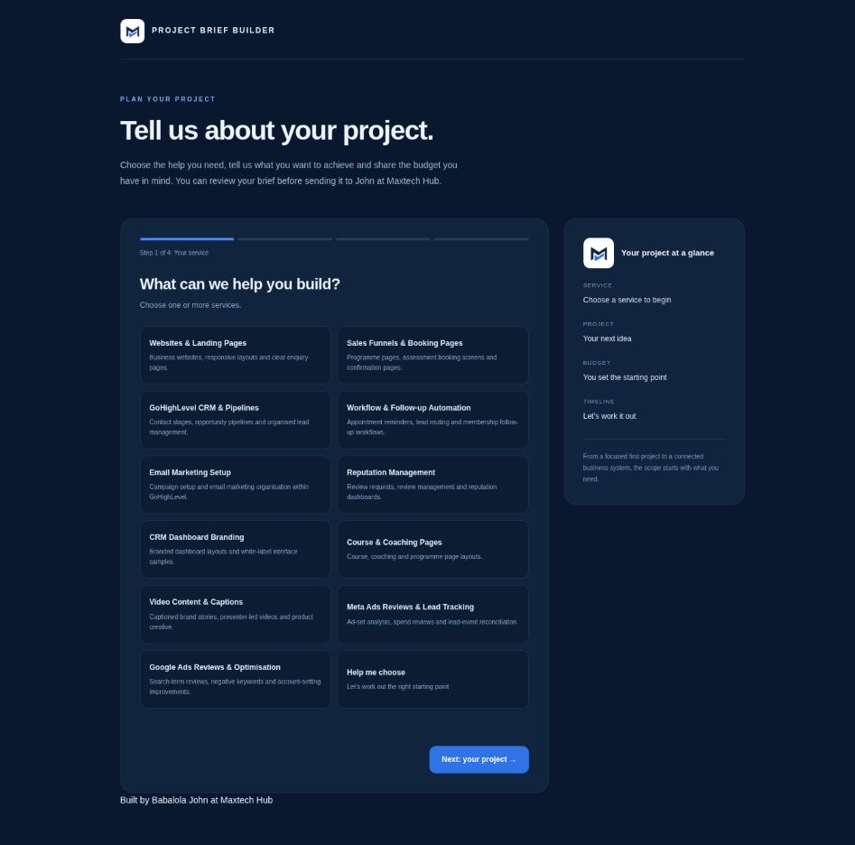

# Project Brief Builder

A simple way for a prospective client to explain what they need before a project discussion.

I built this example for Maxtech Hub using HTML, CSS and JavaScript. Visitors choose a service, describe their project, select a budget and review a brief they can download or send through WhatsApp.



## What it does

The form walks through four stages: service, project, budget and contact details. It supports US dollar and Nigerian naira budgets, a custom amount and an option to ask for guidance. The visitor can return to earlier steps and edit the information before generating the brief.

Required fields are checked in the browser. The completed brief is available as a text download. The WhatsApp button opens a message addressed to Maxtech Hub, and the visitor chooses whether to send it.

## Run the project

Open `index.html` in a browser. There are no packages to install and no build step.

You can also serve the folder locally:

```sh
python3 -m http.server 8080
```

Then open `http://localhost:8080`.

## Files

| File | Purpose |
| --- | --- |
| `index.html` | Page layout, styling and form logic |
| `assets/maxtech-logo.png` | Maxtech Hub brand mark |
| `assets/brief-builder-preview.png` | Preview of the service selection screen |

## Scope

This is a front end example. It does not save entries to a CRM, process payments or create appointments. Form details are held in page memory until the visitor downloads the brief or opens WhatsApp. No message is sent automatically.

The WhatsApp destination is Maxtech Hub’s public business number. Replace that number before adapting the example for another business. A CRM integration would need its own authorised backend and server side validation.

## Checks

The service requirement, budget selection, brief preview, text download and return to editing were checked in a browser. JavaScript syntax was also checked with Node.js.

## Contact

[View the project portfolio](https://github.com/johnwizardbushub-lgtm/maxtech-hub-portfolio)

[Book a free 15 minute consultation](https://calendar.app.google/csjf59513gg1Fxji8)
